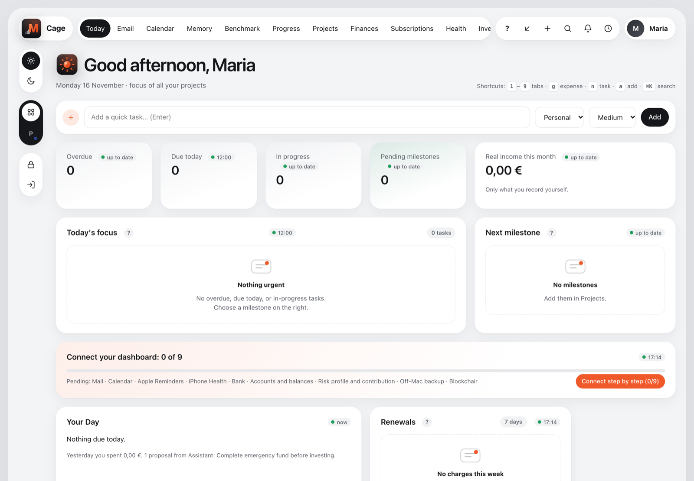
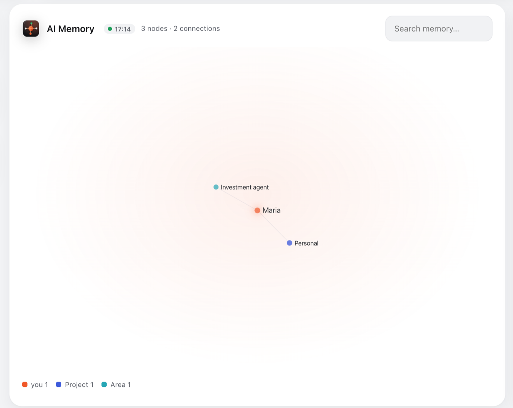
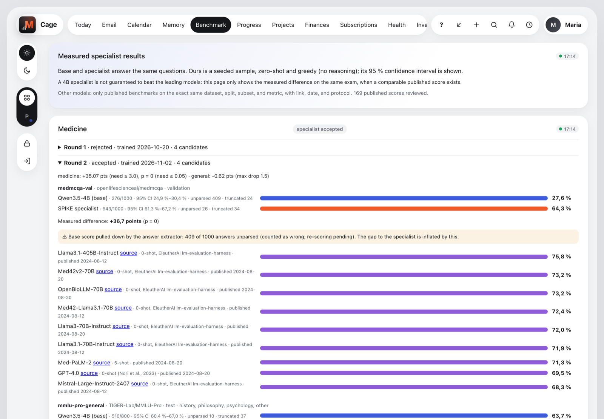
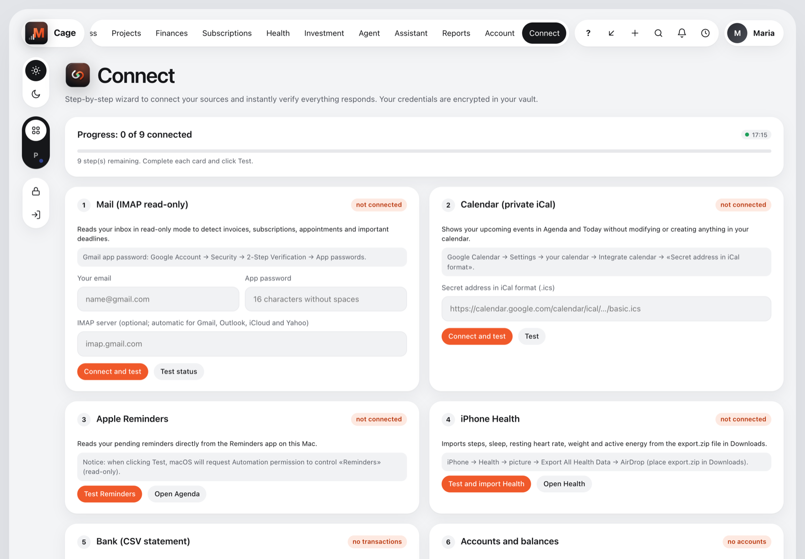

<p align="center"></p>

<h1 align="center">Cage</h1>

<p align="center"><b>A private, local-first command center for your life.</b><br>
Projects, money, subscriptions, health, mail, calendar, an AI memory shared with your local models,<br>
and a paper-trading research agent that tells you when it has <i>no</i> edge. Everything stays on your Mac.</p>

<p align="center">Works with <a href="https://github.com/oddlyprovenai/spike">SPIKE</a> · Apache-2.0 · macOS</p>

---

## Why Cage

- **Yours, encrypted, offline-first.** One AES-256-GCM vault on your disk, unlocked with your password (scrypt). The
  server listens on `127.0.0.1` only, with CSRF, Host/Origin checks and a strict Content-Security-Policy.
- **0 MB when closed.** The server starts on demand and shuts itself down after 2 minutes without use.
- **Every number has a source.** Each card shows where its data comes from, when, and whether it is fresh, stale,
  missing or disagrees between two sources. Nothing is shown as true if it could not be checked.
- **Honest numbers.** The investing agent runs on paper by default, compares everything with simply holding an index,
  counts every variant it tries (deflated Sharpe ratio) and keeps a held-out period it never looks at while choosing.
  If nothing beats the index, it says so and stays indexed.
- **Your name, your logo.** The first time you open Cage it asks for your name and a password; the logo is drawn with
  your initial.

## Screenshots

Fresh install, demo user "Maria", no data connected yet.

| Today | Memory |
|---|---|
|  |  |
| **Benchmark** (SPIKE's published results) | **Connect** |
|  |  |

## What's inside

| Tab | What it does |
|---|---|
| Today | Your day: what is due, agenda, reminders, renewals, expiring documents, yesterday's spending, proposals |
| Connect | Step-by-step setup of every source, each with a **Test** button |
| Mail | Read-only IMAP inbox (app password stored encrypted): important mail, bills, subscriptions, deadlines, drafts written by your local model |
| Agenda | Private iCal calendar, Apple Reminders (on demand), documents and deadlines |
| Memory | An animated neural orb of everything your AIs know about your projects. Two levels: a shared plain-text level your local AIs can read, and a private encrypted level that never leaves the vault |
| Benchmark | SPIKE specialists vs their base model, with confidence intervals, unparsed answers and only *comparable* published scores of other models |
| Projects | Traffic-light status per project (repos, tasks, SPIKE runs, read-only) and the decisions only you can take |
| Finance / Subscriptions | Accounts, budgets, bank CSV import (in the browser), recurring-charge and price-rise detection |
| Health | Weight, food, habits, and the Apple Health export (steps, sleep, resting heart rate) |
| Agent | Paper portfolio and allocator, research studies, news, on-chain context (optional Blockchair key) and a self-custody wallet path that is **off and locked by default** |
| Assistant | Chat with a **local** model (llama.cpp / Ollama / LM Studio on `127.0.0.1` only) |
| Reports / Account | Weekly and monthly reviews generated from your own data, encrypted backups with restore tests, system health |

## Install (one command)

Requirements: macOS 12 or later, Python 3.10+.

```bash
git clone https://github.com/oddlyprovenai/cage.git && cd cage && ./install.sh
```

This copies Cage to `~/Library/Application Support/Cage/app`, keeps your encrypted data in `~/.cage`, registers an
on-demand user service on port 8787 and adds `~/Applications/Cage.app` (with an alias on your Desktop). Open the app,
choose your name and a password, then go to **Connect**. Running `./install.sh` again updates the code and keeps your data.

Optional 24/7 paper agent (prices, news, allocator, monthly re-evaluation; about 25 MB while running): `./install.sh --with-agent`.

Optional extras: `pip install solders mnemonic base58` (self-custody wallet), `pip install numpy scikit-learn scipy`
(research studies), a local LLM server for the Assistant.

## Works with SPIKE

[SPIKE](https://github.com/oddlyprovenai/spike) is an open-source family of small local specialist models.
Cage is its home on your desktop:

- **Benchmark** reads SPIKE's published results (`docs/results/specialists.json`) read-only and shows each specialist
  against its base model, with confidence intervals and unparsed answers. Other models only appear when a published
  score uses the same dataset, split, subset and metric; everything else is "no comparable data".
- **Memory** gives SPIKE (and any local model) a shared, plain-text view of your projects and decisions, without
  your private data.
- **Assistant** can talk to a SPIKE model running locally.

## Money: please read

- **Not financial advice.** Cage is a personal tool and a research notebook.
- **Paper by default.** Real-money modes are off and locked; turning them on requires typing an explicit phrase and
  setting a capital cap, and every real order must be confirmed by you.
- **No measured edge.** In its own tests the agent has not found a strategy that reliably beats simply holding an
  index after costs and taxes; it says so in the app and stays indexed. Past results do not predict future ones.
- The self-custody wallet path has an allow-list of tokens and programs, simulates every transaction on two RPCs before
  signing, caps slippage and fees, and has **no function to send funds to other addresses**. Losing your 24 words means
  losing the money; on-chain activity is public. Taxes still apply (Cage exports a FIFO report).

## Privacy

All data lives in `~/.cage` on your Mac. Cage only talks to the public sources you enable (market prices, news feeds,
your mail server, your calendar URL, optional Blockchair). There is no telemetry and no account.

## Development

```bash
python3 -m venv .venv && .venv/bin/pip install cryptography solders mnemonic base58 numpy scikit-learn scipy pytest
CAGE_OFFLINE=1 .venv/bin/python -m pytest -q
```

## License

Apache License 2.0. See [LICENSE](LICENSE).
